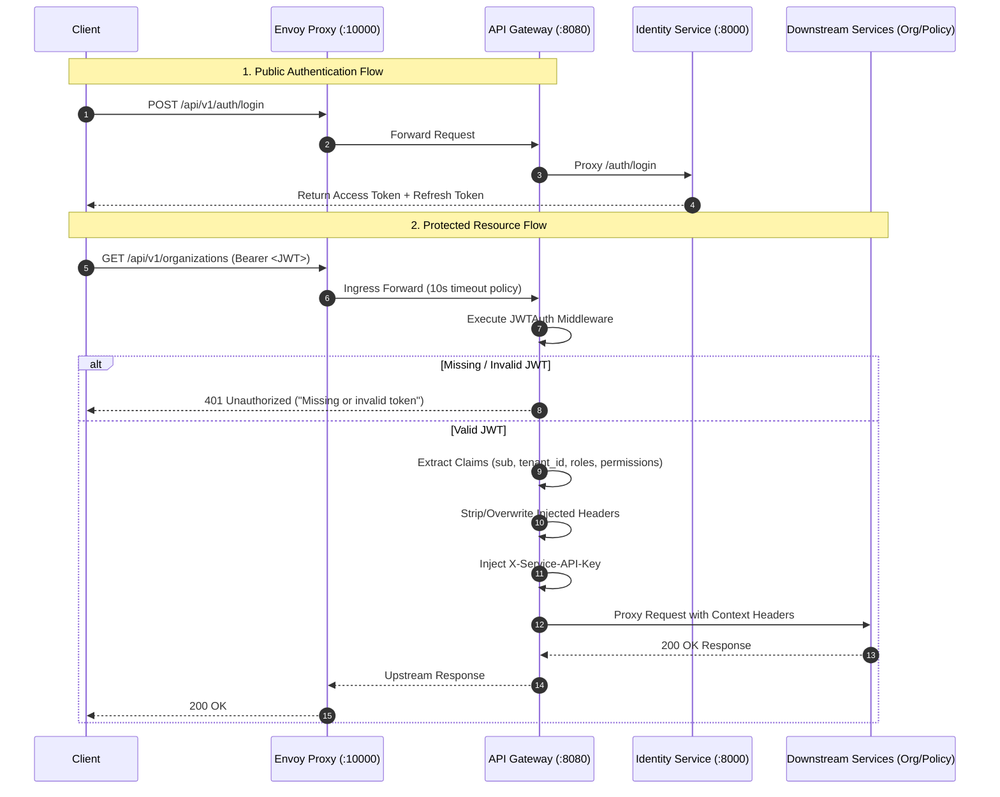

```markdown
# Gateway Authentication Architecture & Flow

## Overview
The API Gateway serves as the single public edge proxy entry point for all platform traffic. It terminates incoming client requests, enforces authentication, sanitizes client-supplied headers to prevent identity spoofing, and forwards validated context headers to downstream microservices.

---

## Edge Architecture

1. **Envoy Reverse Proxy (`:10000`):**
   - Public ingress handling transport layer resilience, request retries (3x on 5xx and network dropouts), and edge timeouts (10s).
   - Routes `/health` directly without authentication.
   - Forwards all protected traffic to the Go API Gateway core (`gateway-app:8080`).

2. **Go API Gateway Router (`:8080`):**
   - Built on Echo v4.
   - Public route bypass: `/health`, `/docs`, and `/api/v1/auth/*` (Login and Refresh) bypass token validation.
   - Protected route group: All endpoints under `/api/v1/*` (e.g., `/users`, `/organizations`, `/policies`) require valid JWT authentication.

---

## Sequence Diagram

> **Implementation Status:** The JWTAuth Middleware and header injection logic outlined in the protected resource flow below represent the target architecture and are currently pending merge into the main branch.



---

## Header Propagation & Spoofing Defense

To ensure external clients cannot spoof administrative or tenant context, the Gateway strictly enforces header sanitization:

* External values supplied for `X-User-Id`, `X-Tenant-Id`, `X-User-Roles`, `X-User-Permissions`, and `X-Service-API-Key` are explicitly overwritten using `Header.Set()`.
* Downstream microservices rely on `X-Service-API-Key` to verify that requests originated through the trusted Gateway perimeter.

```

```